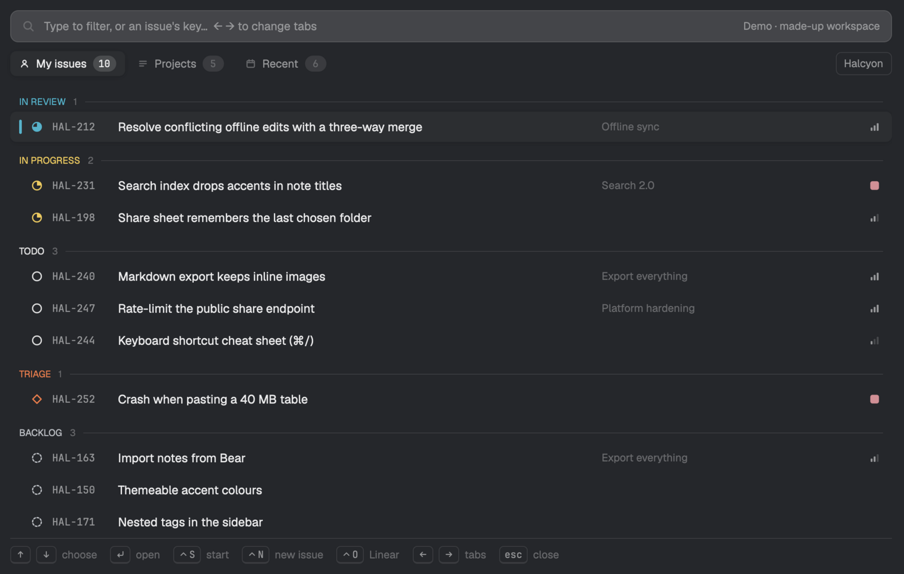

# Linear

Your Linear issues, one key from a worktree with an agent already working on them. Press s on an issue and it's done: In Progress, assigned to you, a fresh worktree on Linear's own branch name, and Claude Code started in it with the ticket. Browse your issues and projects by status, change status, file a new issue, find any issue by its key, and follow links to its pull requests and to the agents on it, across every machine and every workspace you're signed in to.

Picking up an issue means finding it, moving it to In Progress, making a
branch and a worktree, and telling an agent about it. This popup (⌘L) does
all of that from one key, for every workspace you're signed in to, from any
machine:

- **Your issues by status,** in Linear's own colours, with their priority,
  project and who has them; the workspace's projects, and what you filed
  lately. Type an issue's key, or words your own issues don't match, to find
  any issue in the workspace.
- **Read an issue** (status, priority, labels, cycle, due date and its
  description) and **change its status** from the team's own workflow.
- **Start it in one key:** checked first (never a closed issue, or a
  coworker's), then a worktree on Linear's branch name, In Progress and
  yours, and a new space with Claude Code asked to work on it (`/ticket`
  where you have one).
- **File a new issue** without leaving the window: team, status, priority,
  project, assignee.
- **Links both ways:** an agent's issue in Recap, and a pull request's in
  GitHub, open here; `esc` goes back.
- **Nothing else to install,** and it signs you in itself.

## What it is

A popup mod (`mod.json`: an overlay popup at the top, 80% of the window),
opened with ⌘L. It's the Herdr app's side of
[herdr-linear](https://github.com/mrolafsson/herdr-linear), whose code does
the work.

## Installing it (for the agent adding it)

1. Copy `mods/linear/` to `~/.config/herdr-app/mods/linear/`.
2. Merge `keys.json` into the person's: add its sections and keys; ask
   before replacing a key they already bind to something else.
3. `herdr-app check ~/.config/herdr-app/mods/linear`.

**Already installed? That's an update, not a clash.** If `mods/linear/`
exists and is this mod (its `main.js` sets `LINEAR_VERSION` and fetches
herdr-linear), replace its files with these, in place: don't install a
second copy under another name. Its keys are merged already; step 2 only
adds any new ones.

**A different mod named `linear`?** Then rename this one, and everything
that names it follows: the folder; `ICONS` in `look.js`
(`mods/<name>/icons`); in `keys.json`, the section `mod:linear` and its
actions `linear.escape`, `linear.tab` and `linear.backtab`, and
`mod.open:linear`. Recap and GitHub open issues
in a mod named `linear`: renamed, they open them in the browser instead.

That's all. **Don't install herdr-linear, or anything else, on any
machine, and don't sign in for the person:** the mod fetches the
herdr-linear release it needs onto each machine it works on by itself, and
offers the sign-in when there's none (a terminal running
`herdr-linear login`, which opens Linear in their browser). It shares the
sign-in with herdr-linear's TUI plugin, so a machine signed in to either is
used as is. What it needs there: git, and `curl`, `tar` and `sha256sum` or
`shasum`, which macOS and Linux have.

To see that it works: open it (⌘L). The first opening takes a few seconds
longer while herdr-linear is fetched; then it lists the person's issues, or
offers to sign in. "Try the demo" there, or `herdr-app do linear.demo`
while it's open, shows a made-up workspace.

## What it does, and asks

- Runs `herdr-linear app` (one JSON request in, one answer out) through
  `exec(…, { on: machine })` on the machine signed in to Linear: lists,
  an issue, a project, its status, starting it, creating one. Tokens stay
  where herdr-linear keeps them (the macOS keychain, the Linux keyring or a
  file only the person can read); the mod never sees them.
- **Runs programs and reaches the network:** the first time it asks a
  machine, it downloads the herdr-linear release it names
  (`LINEAR_VERSION` in `main.js`) from GitHub for that machine, checks it
  against the release's `checksums.txt`, and keeps it in
  `~/.local/share/herdr-linear/app/<version>/`, apart from any TUI install.
- **Worktrees:** on the machine of the shown space, in its repo (or the
  team's, from `repos` in herdr-linear's `config.json`), it adds a worktree
  in `~/.herdr/worktrees/<repo>/<branch>` (as the app's own worktree mod
  does) from the base branch, then opens it with `space.new`; for start,
  with the first installed agent from `knownAgents` (Claude Code first) and
  its first message.
- **Start changes Linear:** after the worktree, and only once the issue has
  been read again and is still open and the person's (or nobody's), it
  moves it to the team's first started status and assigns it to them.
- Lists the app's agents on an issue's branch; a click goes to one with
  `agent.focus`.
- Opens links with the system's browser and copies keys and branches to
  the clipboard.
- Keeps, in its own `localStorage`, which machine answered, the workspace
  and tab it was on, the team it last filed in and the worktrees it made;
  and its last lists in `linear-cache.json` in the app's home, to show them
  at once on opening while fresh ones load.

## Its look

Recap's and GitHub's: neutral surfaces, colour only on state, and here a
status drawn in Linear's own colour for it: a ring that fills as it goes
(triage a diamond, backlog dashed, done filled, canceled struck through).
Priorities are Linear's bars, urgent a filled square. Drawn icons in
`icons/`, 16px with a 1.6 stroke, tinted with the text colour. Cards with a
raised surface, a shadow and an edge in their status's colour when chosen;
details are chips. JetBrains Mono for keys, branches and teams.

## Keys (`keys.json`)

`cmd-l` opens it; `tab` and `shift-tab` move between the new issue's
title and description (the app's own Tab doesn't reach the form);
`escape` leaves a menu, then a screen (back to the list,
or to Recap or GitHub if they opened it), then the popup. In the list: type
to filter (or an issue's key), ← → for the tabs, ↑ ↓ and Enter; `ctrl-s`
starts, `ctrl-n` files a new issue, `ctrl-o` opens it in Linear, `ctrl-t`
switches workspace. On an issue: `w` worktree, `s` start, `c` status, `n`
new issue, `o` open in Linear, `y` copy its key, `b` copy its branch. Every
key is also a click along the bottom. `linear.demo` (with `herdr-app do`,
while it's open) switches to a made-up workspace for that opening.
